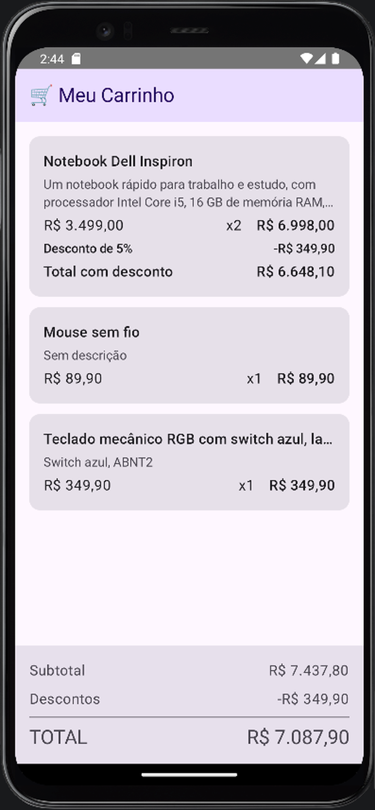
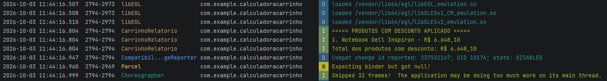

# Calculadora de Carrinho de Compras

Aplicativo Android desenvolvido com **Kotlin** e **Jetpack Compose** para a ATV1 de PDM II.

**Aluno:** Carlos Eduardo Campos Takeshita

O app carrega um catálogo fixo de produtos, aplica as regras de desconto, exibe os itens do carrinho na tela com um componente reutilizável e gera um relatório no Logcat com os produtos que tiveram desconto.

## Capturas de tela

### Emulador

### Logcat

## Organização do código

Todos os arquivos ficam em `app/src/main/java/com/example/calculadoracarrinho/`.

| Arquivo | Responsabilidade |
|---|---|
| `Modelos.kt` | Interface `Pagavel` e as classes `Produto`, `ItemCarrinho` e `Carrinho` |
| `RegrasDeNegocio.kt` | Camada de domínio: funções puras de cálculo, formatação e geração do relatório |
| `Catalogo.kt` | Catálogo fixo com 7 produtos e o carrinho do cenário de validação |
| `CarrinhoScreen.kt` | Interface em Jetpack Compose: `TelaCarrinho`, `LinhaProduto` e `ResumoCarrinho` |
| `MainActivity.kt` | Ponto de entrada: imprime o relatório no Logcat e exibe a tela |

## Decisões de implementação

- **Modelagem:** `Produto` tem descrição anulável (`String?`) e desconto com valor padrão zero. `ItemCarrinho` e `Carrinho` implementam `Pagavel`, cada um com o seu `calcularTotal()`.
- **Domínio:** os cálculos são funções puras, separadas da interface. A tela apenas chama essas funções e mostra o resultado.
- **Coleções:** o relatório usa `filter` (só itens com desconto), `map` (nome e valor final), `sortedByDescending` (do maior para o menor) e `fold` (soma dos totais).
- **Componente reutilizável:** `LinhaProduto` recebe tudo por parâmetro e é chamado dentro de um `forEach` sobre os itens do carrinho.
- **Tipografia:** apenas estilos do Material Design 3 (`MaterialTheme.typography`), sem tamanho de fonte manual.
- **Textos longos:** nome com `maxLines = 1`, descrição com `maxLines = 2`, ambos com `TextOverflow.Ellipsis`.
- **Valores nulos:** a descrição é tratada com o operador Elvis (`descricao ?: "Sem descrição"`), sem uso de `!!`.

## Cenário de validação

| Produto | Preço unitário | Desconto | Quantidade |
|---|---|---|---|
| Notebook Dell Inspiron | R$ 3.499,00 | 5% | 2 |
| Mouse sem fio | R$ 89,90 | 0% | 1 |
| Teclado mecânico RGB | R$ 349,90 | 0% | 1 |

Resultado exibido no resumo da tela:

- **Subtotal:** R$ 7.437,80
- **Descontos:** -R$ 349,90
- **Total:** R$ 7.087,90

## Como executar

1. Abra o projeto no Android Studio.
2. Aguarde a sincronização do Gradle.
3. Execute em um emulador ou dispositivo Android.
4. Para ver o relatório, abra o Logcat e filtre pela tag `CarrinhoRelatorio`.
